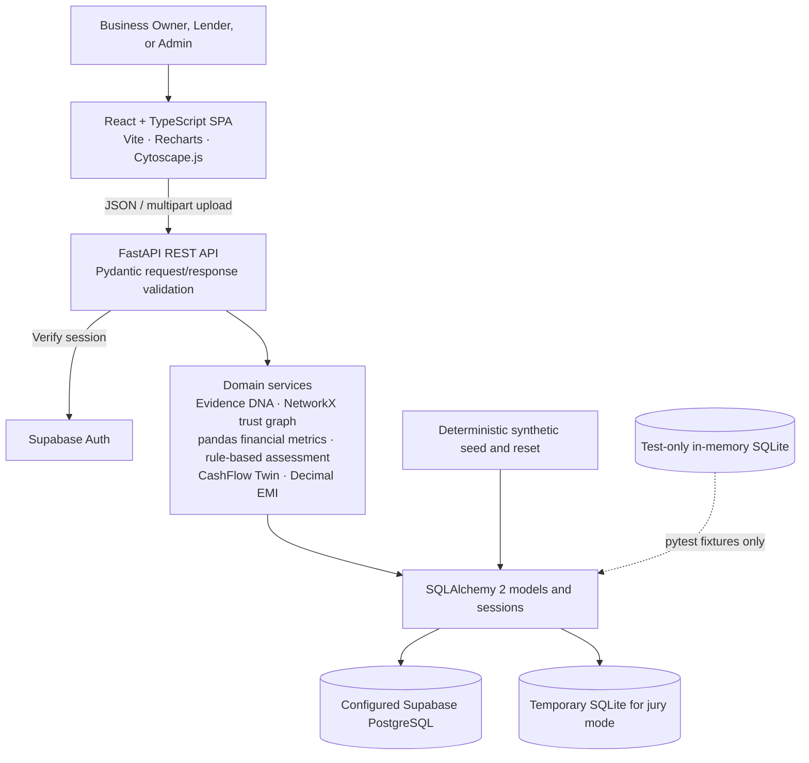

# CREDWEAVE AI architecture

## System boundaries

The standard development setup uses the configured PostgreSQL `DATABASE_URL`. The explicit jury launcher serves the built React app and API from one loopback URL, provisions temporary SQLite, seeds the fixed synthetic businesses, and creates their assessment snapshots at startup. The bank and UPI records are simulated.

## Data flow

1. Supabase verifies a user session. The API resolves the application role and scopes business operations to ownership or an active lender grant.
2. The API accepts bounded transaction, invoice, supplier, or obligation CSV/JSON input, validates the schema and values, detects duplicate file hashes, and stores successful imports with source provenance. Import application is transactional.
3. Deterministic services derive evidence findings, candidate invoice/payment links, trust-graph nodes and edges, monthly cash-flow metrics, risk indicators, stress scenarios, and illustrative loan options.
4. The assessment endpoint stores an immutable snapshot. The Credit Passport reads the latest snapshot and presents its derivation, sources, assumptions, and limitations; changing input data requires a new assessment.
5. Consent-gated manual review records a status, authenticated reviewer account, checklist, comment, timestamp, and rule version. The review state is not an approval/denial.

No inferred match establishes transaction authenticity. Missing and unmatched data remain unknown evidence. Financial health describes observed cash movement and must not be presented as accounting profit.

## Persistence

SQLAlchemy models cover portal accounts, businesses and lender consent grants, data-source metadata, transactions, invoices, counterparties, obligations, invoice/payment links, assessment snapshots, and review records. CSV content is parsed into normalized fields; logs should not contain raw rows. Identifiers are masked where appropriate.

Schema setup currently uses `create_all` and limited in-place compatibility checks. It is not a versioned migration system and is not appropriate for production schema lifecycle management.

## API route inventory

All application routes are under `/api`. Interactive API documentation is available at `/docs` while the local backend is running.

| Method | Route | Purpose |
|---|---|---|
| GET | `/api/health` | Service version and demo-mode indicator |
| POST | `/api/auth/{login,register,refresh,logout}` | Supabase-backed portal session |
| GET | `/api/me` | Current portal account and role |
| GET | `/api/admin/accounts` | List accounts, Admin only |
| PUT | `/api/admin/accounts/{account_id}/role` | Assign or remove Lender role, Admin only |
| POST | `/api/businesses` | Create a business in the current owner's workspace |
| GET | `/api/businesses` | List businesses |
| GET | `/api/businesses/{id}` | Get a business |
| PUT | `/api/businesses/{id}` | Edit profile and upload consent, owner only |
| GET | `/api/businesses/{id}/records` | Page through normalized records |
| GET | `/api/businesses/{id}/shares` | List active named lender grants, owner only |
| PUT / DELETE | `/api/businesses/{id}/shares/{lender_id}` | Grant or revoke lender access, owner only |
| POST | `/api/demo/load` | Reset fixed synthetic fixtures inside the isolated jury server |
| POST | `/api/businesses/{id}/imports/transactions` | Import validated transaction CSV |
| POST | `/api/businesses/{id}/imports/invoices` | Import validated invoice CSV |
| POST | `/api/businesses/{id}/imports/suppliers` | Import a supplier directory with masked identifiers |
| POST | `/api/businesses/{id}/imports/obligations` | Import obligations CSV or JSON |
| GET | `/api/businesses/{id}/sources` | List source metadata |
| GET | `/api/businesses/{id}/records-summary` | Counts and synthetic-data summary |
| GET | `/api/businesses/{id}/evidence-dna` | Completeness, consistency, verification counts, confidence, claim trail |
| GET | `/api/businesses/{id}/evidence-findings` | Evidence findings with source/record provenance |
| GET | `/api/businesses/{id}/trust-graph` | Typed graph, anomalies, metrics, and provenance |
| GET | `/api/businesses/{id}/graph-findings` | Graph review findings |
| GET | `/api/businesses/{id}/financial-summary` | Monthly cash-flow and coverage metrics |
| POST | `/api/businesses/{id}/assess` | Create immutable rules-only assessment snapshot |
| GET | `/api/businesses/{id}/assessments/latest` | Retrieve latest snapshot |
| GET | `/api/businesses/{id}/stress-tests/presets` | List deterministic scenario presets |
| POST | `/api/businesses/{id}/stress-tests` | Run an editable deterministic scenario |
| POST | `/api/businesses/{id}/loan-options` | Calculate illustrative EMI/affordability options |
| GET | `/api/businesses/{id}/credit-passport` | Retrieve passport from latest assessment |
| GET | `/api/businesses/{id}/review-workspace` | Load human review context |
| POST | `/api/businesses/{id}/reviews` | Record manual review status and notes |
| POST | `/api/businesses/{id}/consent` | Update consent flags inside the isolated jury server |

The passport's print/download action is browser print-to-PDF; there is no server-side PDF export endpoint.

## Frontend routes and service boundaries

The React app provides onboarding and business profile pages plus overview, evidence, trust graph, financial health, rules-based risk, CashFlow Twin, loan comparison, passport, and reviewer desk screens. The frontend API client (`frontend/src/lib/api.ts`) makes the HTTP calls. Domain calculations are backend-owned; charts and graph layout are rendered in the browser.

## Trust and access boundaries

FastAPI enforces account ownership, lender consent grants, and administrator permissions. Portal tables deny direct access from Supabase browser-facing roles, with the FastAPI connection acting as the data gateway. The isolated jury server bypasses sign-in for its own synthetic data. [Security and deployment controls](SECURITY_LIMITATIONS.md)
